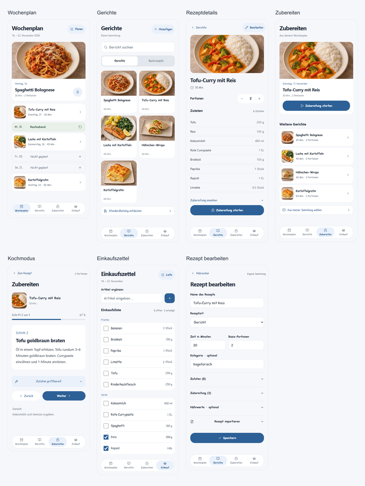
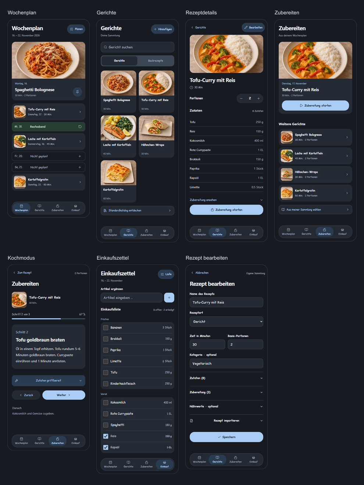

# UI-Referenz · 14. November 2026

Gesicherter Stand der gemeinsam entwickelten Wochentisch-Mockups. Gestaltungsrichtung: **Fokus / Wochenmenü**, Comic Relief, blaue Aktionen, Fotos für Gerichte und kompakte Zeilen für freie Tage und Resteabende. Die produktive App ist damit noch nicht umgestellt.

## Schnell zugreifen

- **[Interaktive Vorschau öffnen](preview.html):** Datei lokal im Browser öffnen. Hell/Dunkel und Screen-Reiter funktionieren ohne Internet. Alle benötigten Bilder, Schriften und Icons sind eingebettet.
- **[Styleguide](../../../STYLEGUIDE.md):** Regeln, Komponenten, Farbwerte und Vorgaben für die Umsetzung.
- **[Übersicht hell](overview-light.png)** und **[Übersicht dunkel](overview-dark.png):** alle sieben Screens auf einen Blick.
- **[Screenshot-Verzeichnis](screenshots/):** 22 Einzelaufnahmen einschließlich wichtiger Zustände.

Die Vorschau enthält ausschließlich Beispieldaten. Suche, Portionswahl, Kochschritte, Einkaufsliste und Gerichtzuordnung lassen sich ausprobieren. Manche Menüpunkte und der Rezeptimport zeigen nur den vorgesehenen Einstieg. Speichern verändert keine produktiven Daten und persistiert keine Rezepte.

## Screens

Die PNGs zeigen den vollständigen Screen-Inhalt bei einer Browserbreite von 390 CSS-Pixeln. Lange Ansichten sind deshalb höher als ein einzelner Telefonbildschirm.

| Screen | Hell | Dunkel |
| --- | --- | --- |
| Wochenplan | [PNG](screenshots/light/01-wochenplan.png) | [PNG](screenshots/dark/01-wochenplan.png) |
| Meine Gerichte | [PNG](screenshots/light/02-gerichte.png) | [PNG](screenshots/dark/02-gerichte.png) |
| Rezeptdetails | [PNG](screenshots/light/03-rezeptdetails.png) | [PNG](screenshots/dark/03-rezeptdetails.png) |
| Zubereiten: Gericht auswählen | [PNG](screenshots/light/04-zubereiten.png) | [PNG](screenshots/dark/04-zubereiten.png) |
| Kochmodus | [PNG](screenshots/light/05-kochmodus.png) | [PNG](screenshots/dark/05-kochmodus.png) |
| Einkaufszettel | [PNG](screenshots/light/06-einkaufszettel.png) | [PNG](screenshots/dark/06-einkaufszettel.png) |
| Rezept bearbeiten | [PNG](screenshots/light/07-rezept-bearbeiten.png) | [PNG](screenshots/dark/07-rezept-bearbeiten.png) |

### Weitere Zustände

| Zustand | Hell | Dunkel |
| --- | --- | --- |
| Planen-Menü geöffnet | [PNG](screenshots/light/08-wochenplan-menue.png) | [PNG](screenshots/dark/08-wochenplan-menue.png) |
| Mahlzeitfilter im Menü „Liste“ | [PNG](screenshots/light/09-einkaufsfilter.png) | [PNG](screenshots/dark/09-einkaufsfilter.png) |
| Pop-up mit Gerichtzuordnung | [PNG](screenshots/light/10-artikel-gerichtzuordnung.png) | [PNG](screenshots/dark/10-artikel-gerichtzuordnung.png) |
| Weitere Artikel abgehakt | [PNG](screenshots/light/11-artikel-abgehakt.png) | [PNG](screenshots/dark/11-artikel-abgehakt.png) |

## Wichtige Interaktionen

- **Wochenplan:** „Planen“ bündelt die Wochenwahl und „7 Tage mischen“. Vorräte gehören in den Ablauf des Mischens und haben keinen eigenen Menüpunkt. Freie Tage bleiben einzeln sichtbar und antippbar; Resteabende sind grün.
- **Gerichte:** Suche und Rezeptart-Umschaltung; ein Gericht öffnet die Rezeptansicht. Hinzufügen führt zum Editor.
- **Rezept:** Die Portionswahl skaliert die Zutatenmengen. „Zubereitung starten“ öffnet den Kochmodus.
- **Kochen:** Vorheriger/nächster Schritt und aufklappbare Zutaten.
- **Einkauf:** Artikel direkt oben ergänzen. Filtern über „Liste“. Abhaken streicht Name und Menge durch, ohne Artikel zu verschieben.
- **Gerichtzuordnung:** Einen Einkaufsartikel etwa 500 ms gedrückt halten. Alternativ Rechtsklick oder Enter/Shift+F10 auf der fokussierten Checkbox. Das Pop-up lässt sich über das Kreuz, Escape oder Antippen außerhalb schließen. Scrollen bricht die Haltegeste ab.

Die Einkaufszeilen zeigen ausschließlich Checkbox, Artikelname und Menge. Emojis und dauerhafte Gericht-Unterzeilen sind ausgeblendet. Die experimentell erzeugte Banane ist kein Bestandteil dieses abgestimmten Stands.

## Für die spätere Umsetzung

Styleguide und Screenshots gemeinsam verwenden: Der Guide beschreibt Regeln und Verhalten, die PNGs dokumentieren den sichtbaren Stand, die Vorschau zeigt die Übergänge. Die äußere Telefonumrandung und die Reiter über der Vorschau sind Präsentationshilfen und werden nicht in die App übernommen.

Der Desktop-Aufbau ist noch gesondert zu gestalten. Die Screens zeigen die mobile Richtung, keine fertige Desktop-Oberfläche. Vor einer produktiven Umsetzung die bestehenden Funktionen, Fehler-/Leerzustände, Synchronisierung und Bedienung mit geöffneter Tastatur berücksichtigen.

Dieser datierte Ordner ist ein Referenzstand. Neue größere Designstände in einem neuen datierten oder versionierten Ordner sichern, damit frühere Entscheidungen nachvollziehbar bleiben.

## Dateien und Reproduzierbarkeit

- `preview.html`: eigenständiger Export; ohne Codex, lokale Installation oder Internet im Browser nutzbar.
- `source/mockups.fragment.html`: editierbare Quelle mit eingebetteten Medien. Änderungen daran werden nicht automatisch in `preview.html` übernommen; den Export danach erneuern.
- `source/capture-screenshots.cjs`: erzeugt die 22 Einzelaufnahmen erneut aus `preview.html`. Benötigt Node.js, Playwright und installiertes Google Chrome. Playwright ist nur ein Werkzeug zur Referenzerstellung und keine neue Abhängigkeit der produktiven App. Ein abweichender Modulpfad kann über `WOCHENTISCH_PLAYWRIGHT_MODULE` angegeben werden.
- `source/lucide-LICENSE.txt`: Lizenz der eingebetteten Lucide-Icons, Version 1.8.0.
- `capture-manifest.json`: Browserversion, Viewport, Dateiliste, Prüfsumme der Quelle und Ergebnis der Prüfung ohne externe Netzwerkanfragen.

Vom Projektverzeichnis aus die Screenshots bei vorhandener Werkzeugumgebung neu aufnehmen:

```sh
node docs/ui-reference/2026-11-14/source/capture-screenshots.cjs
```

Aufgenommen in Desktop-Chrome mit Touch-Emulation, **390 × 844 CSS-Pixeln**, Pixelfaktor 1, jeweils Hell/Dunkel. Die Bilder erfassen den vollständigen Inhalt. Kein echter iPhone-/Safari-Test und keine Prüfung einer real geöffneten iOS-Tastatur.

## Übersichten

### Hell



### Dunkel


